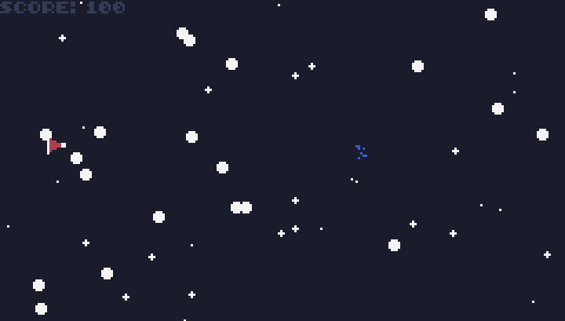

# Santa Shooter

## Un jeu de tir à toi, dans ton navigateur

Des ennemis qui arrivent par la droite, un score qui monte. Tu vas le programmer toi-même, en Lua, dans TIC-80 : une petite console de jeu qui tient dans un onglet.

Dans un quart d'heure, ton Père Noël bouge déjà. À la fin, le jeu a ton ciel, tes effets et tes armes.

## Les quatre parties

1. **Le jeu de base.** Un joueur qui bouge et qui tire, des ennemis, un score.
2. **Effets visuels.** Un ciel étoilé, du parallaxe, des particules, des bonus au choix.
3. **Refactor du code.** Ranger les variables du jeu dans des tables.
4. **Gameplay.** Des défis indépendants, dans l'ordre que tu veux.

Chaque partie se débloque quand la précédente est validée.

## Comment ça marche

- Tout se passe dans le navigateur. Ton code est sauvegardé automatiquement.
- **Ouvrir TIC-80** affiche la console à côté des instructions : le jeu à gauche, ton code à droite.
- Chaque étape : ses outils, un objectif, l'image à obtenir. L'encadrant valide avec un code.
- Bloqué ? Relis l'étape, puis demande à l'encadrant.
