# Le jeu de base

Un joueur qui bouge, qui tire, des ennemis, un score. Les étapes se font dans l'ordre : ses outils, un objectif, l'image à obtenir.

# Intro

1. Clique sur **Ouvrir TIC-80** : la console s'ouvre à côté des instructions.
   <!-- ws:cue runtime -->
2. À gauche le jeu, à droite l'éditeur de code, dessous un terminal Lua pour essayer les exemples.
3. Dans la console : `run` lance le jeu, `studio` ouvre les éditeurs, <kbd>Échap</kbd> revient à la console.

<!-- illustration: la fenêtre TIC-80 à côté du sujet : le jeu, l'éditeur, le terminal Lua ; le bouton Ouvrir TIC-80 et la console encadrés -->

**Un jeu, c'est une boucle.** TIC-80 appelle ta fonction `TIC` 60 fois par seconde.

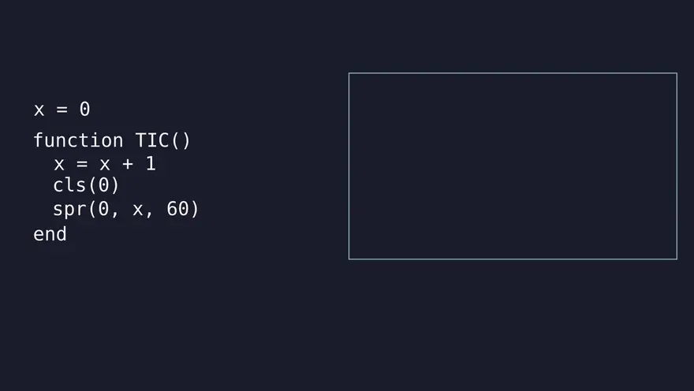
<!-- ws:anim {src: img/intro-boucle.webm, chapters: img/intro-boucle.vtt} -->

# Mouvement joueur

## Sprite
<!-- ws: {type: exercise, id: mouvement-joueur-sprite} -->

Un sprite, c'est un dessin de 8 pixels sur 8. Le tien : le bonnet du Père Noël.

<!-- ws:toolbox -->
### Boîte à outils

> 🧰 **Le studio** : dans la console, tape `studio`. Choisis la case 0, dessine pixel par pixel.
>
> 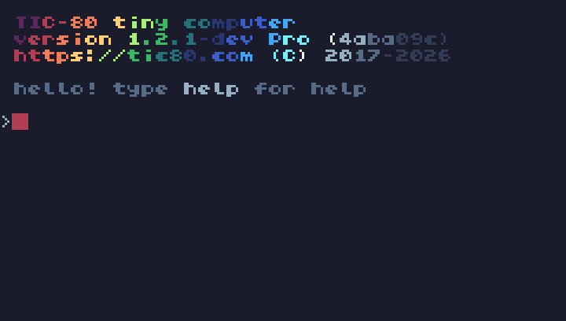
>
> 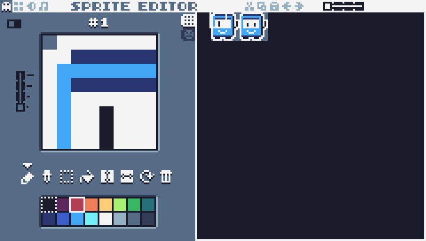

> 🧰 **`spr(id, x, y)`** dessine le sprite `id` à la position `x`, `y`. Toujours après `cls`, qui efface l'écran.
>
> ```lua
> spr(17, 20, 100)   -- le sprite 17, en x = 20 et y = 100
> spr(17, 60, 100)   -- le même, 40 pixels plus à droite
> ```
>
> Doc TIC-80 (en anglais) : [`spr`](https://github.com/nesbox/TIC-80/wiki/spr#parameters), [`cls`](https://github.com/nesbox/TIC-80/wiki/cls#description)

> 🧰 **La transparence** : un 4ᵉ paramètre à `spr`, le numéro de la couleur à rendre invisible. La palette va de 0 (en haut à gauche) à 15.
>
> ```lua
> spr(17, 20, 100, 1)   -- la couleur 1 disparaît
> ```
>
> 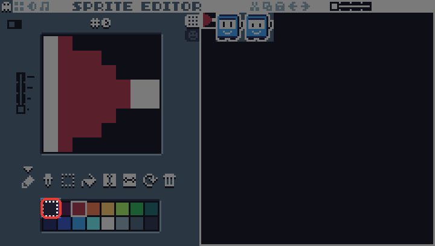
>
> Doc TIC-80 (en anglais) : [`colorkey`](https://github.com/nesbox/TIC-80/wiki/spr#parameters)
<!-- /ws:toolbox -->

### Mise en application
<!-- ws:doit -->

**Ton objectif :** ton bonnet dans le jeu, sans le carré noir autour.

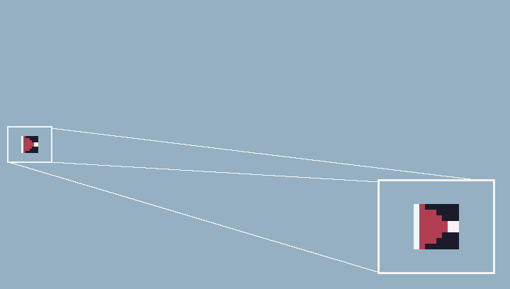

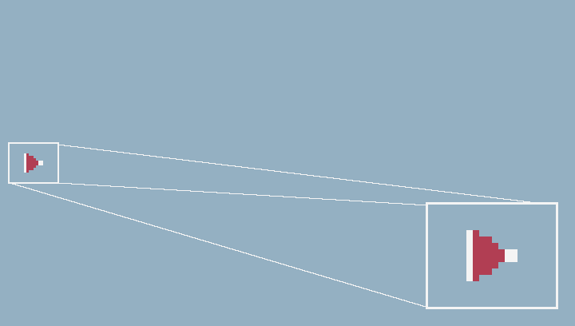

**C'est réussi si :** le bonnet est seul sur le fond, comme sur la deuxième image.

## Input
<!-- ws: {type: exercise, id: mouvement-joueur-input} -->

Le bonnet s'affiche. Maintenant, il bouge avec les flèches.

<!-- ws:toolbox -->
### Boîte à outils

> 🧰 **Une variable** stocke une valeur. Crée-la en haut du code, hors de `function TIC()` : dans `TIC()`, elle serait remise à sa valeur de départ 60 fois par seconde.
>
> ```lua
> vies = 3
> print(vies)   --> 3
> ```
>
> 
> <!-- ws:anim {src: img/outil-variable.webm, chapters: img/outil-variable.vtt} -->
>
> Doc Lua (en anglais) : [les variables](https://www.lua.org/manual/5.3/manual.html#3.2)

> 🧰 **Incrémenter** : Lua calcule la droite du `=`, puis stocke le résultat à gauche.
>
> ```lua
> compteur = 0
> compteur = compteur + 1   --> 1
> compteur = compteur - 1   --> 0
> ```
>
> 
> <!-- ws:anim {src: img/outil-incrementer.webm, chapters: img/outil-incrementer.vtt} -->
>
> Doc Lua (en anglais) : [l'affectation](https://www.lua.org/manual/5.3/manual.html#3.3.3), [`+` et `-`](https://www.lua.org/manual/5.3/manual.html#3.4.1)

> 🧰 **`btn(numéro)`** est vrai tant que la touche est enfoncée.
>
> | Numéro | Touche |
> |---|---|
> | 0 | flèche haut |
> | 1 | flèche bas |
> | 2 | flèche gauche |
> | 3 | flèche droite |
> | 4 | Z |
> | 5 | X |
>
> Doc TIC-80 (en anglais) : [`btn`](https://github.com/nesbox/TIC-80/wiki/btn#parameters)

> 🧰 **`if`** : le bloc s'exécute seulement si la condition est vraie. Chaque `if` se ferme par `end`.
>
> ```lua
> temperature = 35
> if temperature > 30 then
>   print("il fait chaud")
> end
> ```
>
> 
> <!-- ws:anim {src: img/outil-if.webm, chapters: img/outil-if.vtt} -->
>
> Doc Lua (en anglais) : [`if`](https://www.lua.org/manual/5.3/manual.html#3.3.4), [les comparaisons](https://www.lua.org/manual/5.3/manual.html#3.4.4)
<!-- /ws:toolbox -->

### Mise en application
<!-- ws:doit -->

**Ton objectif :** deux variables `x` et `y`, changées par les flèches, utilisées par `spr`.

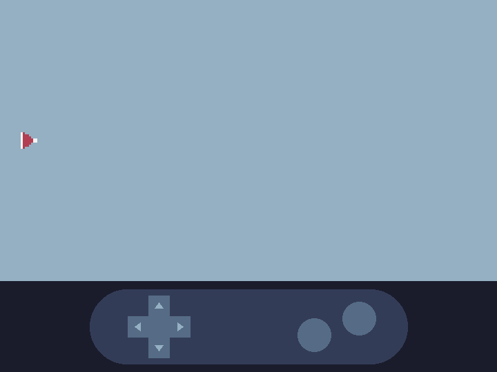

**C'est réussi si :** le bonnet avance tant que la flèche est enfoncée, dans les quatre directions.

## Rester dans les limites de l'écran
<!-- ws: {type: exercise, id: mouvement-joueur-limites} -->

Trop loin, le bonnet sort de l'écran. Il doit s'arrêter contre les bords.

<!-- ws:toolbox -->
### Boîte à outils

> 🧰 **L'écran** fait 240 pixels sur 136. Le point (0, 0) est en haut à gauche.
>
> 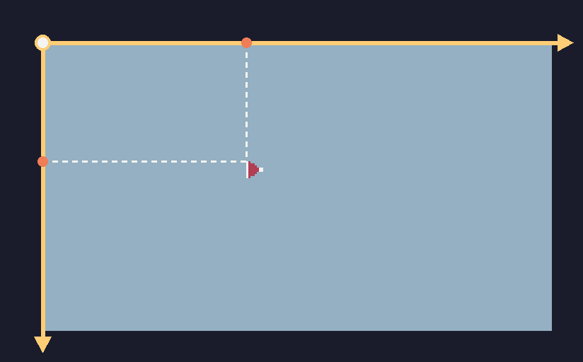

> 🧰 **Les quatre bords** : `x` et `y` sont le coin en haut à gauche d'un sprite de 8 pixels.
>
> 
> <!-- ws:anim {src: img/limites-bords.webm, chapters: img/limites-bords.vtt} -->
<!-- /ws:toolbox -->

### Mise en application
<!-- ws:doit -->

**Ton objectif :** quatre conditions, une par bord.

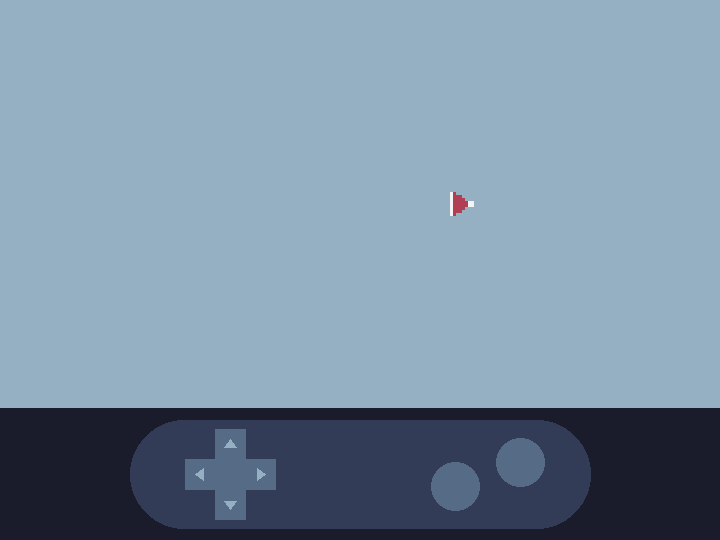


**C'est réussi si :** le bonnet reste entièrement visible, flèche enfoncée ou pas.

# Bullet

## Sprite
<!-- ws: {type: exercise, id: bullet-sprite} -->

Un joueur qui tire, c'est mieux. D'abord, le missile existe.

<!-- ws:toolbox -->
### Boîte à outils

> 🧰 Les outils de cette étape : le studio, `spr`, une variable. Tu les as déjà.
<!-- /ws:toolbox -->

### Mise en application
<!-- ws:doit -->

**Ton objectif :** un missile dessiné dans une autre case, affiché en (10, 10) par deux variables `mx` et `my`.

<!-- illustration: le bonnet et le missile affichés en même temps, le missile en haut à gauche en (10, 10) -->

**C'est réussi si :** missile et bonnet sont visibles en même temps.

## Input
<!-- ws: {type: exercise, id: bullet-input} -->

Un appui sur le bouton de tir lance le missile tout droit, depuis le joueur.

<!-- ws:toolbox -->
### Boîte à outils

> 🧰 **Le vecteur vitesse** : de combien la position change à chaque image. Une variable, ajoutée à la position à chaque tour de `TIC`.
>
> ```lua
> position = 0
> vitesse = 3
> position = position + vitesse   --> 3
> position = position + vitesse   --> 6
> ```
>
> | `vitesse` | La position... |
> |---|---|
> | `1` | augmente doucement |
> | `5` | augmente vite |
> | `-2` | diminue |
> | `0` | ne change pas |
>
> 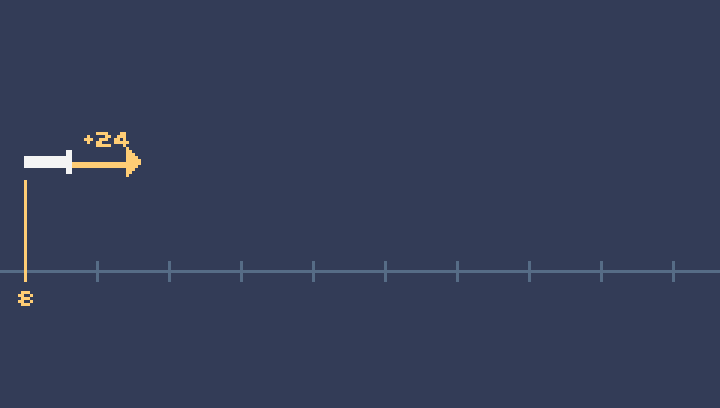
>
> 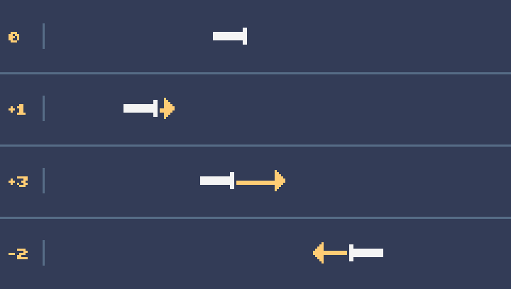
>
> 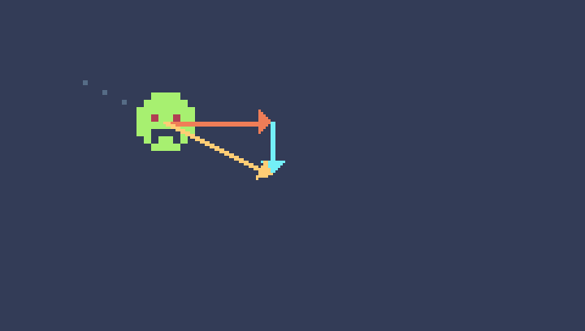
<!-- /ws:toolbox -->

### Mise en application
<!-- ws:doit -->

**Ton objectif :** une vitesse `vmx`. Au tir, le missile prend la position du joueur et une vitesse ; à chaque image, il avance.

<!-- illustration: GIF avec manette : appui sur Z, le missile part de la position du joueur et traverse l'écran vers la droite -->

**C'est réussi si :** le missile part du bonnet et traverse l'écran sans dévier.

## Logique additionnelle
<!-- ws: {type: exercise, id: bullet-logique} -->

Si tu martèles le bouton, le missile est replacé devant le joueur alors qu'il est déjà tiré. Et une fois sorti de l'écran, il n'est jamais remis prêt à être tiré.

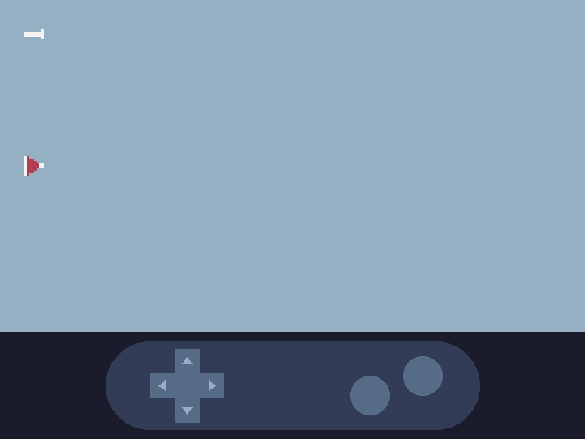

<!-- ws:toolbox -->
### Boîte à outils

> 🧰 **`==`** compare deux valeurs. `=` stocke : `if vies = 0 then` est une erreur.
>
> ```lua
> vies = 0
> print(vies == 0)   --> true
> print(vies == 3)   --> false
> ```
>
> Doc Lua (en anglais) : [les comparaisons](https://www.lua.org/manual/5.3/manual.html#3.4.4)

> 🧰 **`and`** : vrai seulement si les deux conditions sont vraies.
>
> ```lua
> age = 15
> billet = true
> print(age >= 12 and billet)   --> true
> billet = false
> print(age >= 12 and billet)   --> false
> ```
>
> Doc Lua (en anglais) : [`and`, `or`, `not`](https://www.lua.org/manual/5.3/manual.html#3.4.5)

> 🧰 **Un seul missile, deux états : prêt à être tiré, tiré.** Sa vitesse dit dans lequel il est.
>
> 
> <!-- ws:anim {src: img/tir-cycle.webm, chapters: img/tir-cycle.vtt} -->
<!-- /ws:toolbox -->

### Mise en application
<!-- ws:doit -->

**Ton objectif :** le missile est tiré seulement s'il est prêt à être tiré. Sorti à droite, il est remis en (-10, -10), vitesse 0 : prêt à être tiré.


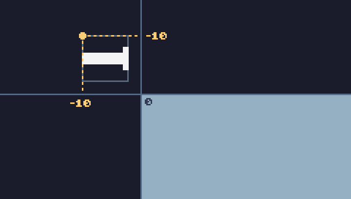

**C'est réussi si :** jamais deux missiles en même temps, et toujours un tir possible après la sortie.

# Enemy

## Sprite
<!-- ws: {type: exercise, id: enemy-sprite} -->

Un ennemi, immobile pour l'instant.

<!-- ws:toolbox -->
### Boîte à outils

> 🧰 **Le studio pendant que le jeu tourne** : <kbd>Échap</kbd>, puis OPEN STUDIO.
>
> 
<!-- /ws:toolbox -->

### Mise en application
<!-- ws:doit -->

**Ton objectif :** ton ennemi, dans une case libre, affiché quelque part sur l'écran.

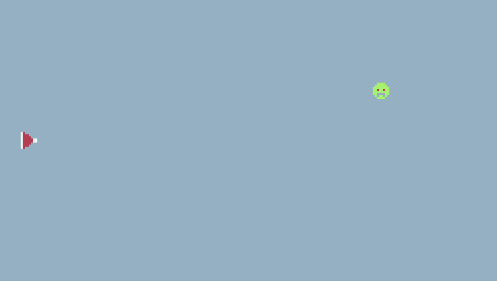

**C'est réussi si :** bonnet, missile et ennemi sont tous les trois à l'écran.

## Mouvement
<!-- ws: {type: exercise, id: enemy-mouvement} -->

L'ennemi avance tout seul vers la gauche. Sorti à gauche, il est replacé à droite, à une hauteur au hasard.

<!-- ws:toolbox -->
### Boîte à outils

> 🧰 **`math.random(min, max)`** : un nombre entier au hasard, entre `min` et `max`. Nouveau à chaque appel.
>
> ```lua
> de = math.random(1, 6)
> print(de)   --> 4 (ou 1, 2, 3, 5, 6 : comme un dé)
> ```
>
> 
> <!-- ws:anim {src: img/outil-random.webm, chapters: img/outil-random.vtt} -->
>
> Doc Lua (en anglais) : [`math.random`](https://www.lua.org/manual/5.3/manual.html#pdf-math.random)

> 🧰 **Une vitesse négative** va vers la gauche : le missile à `-2` de l'étape Bullet recule.
>
> ```lua
> x = 100
> vitesse = -2
> x = x + vitesse   --> 98
> ```
<!-- /ws:toolbox -->

### Mise en application
<!-- ws:doit -->

**Ton objectif :** `ex`, `ey`, `vex`, `vey`. Il commence un peu à droite de l'écran, à un `ey` aléatoire, et y est replacé quand il sort à gauche.

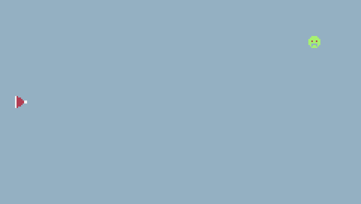

**C'est réussi si :** après chaque sortie, l'ennemi est replacé à droite, jamais à la même hauteur.

# Collision

## Enemy VS Player
<!-- ws: {type: exercise, id: collision-enemy-player} -->

L'ennemi passe sur le bonnet sans que rien n'arrive. Quand ils se touchent, les deux sont replacés à leur position de départ.

<!-- ws:toolbox -->
### Boîte à outils

> 🧰 **La boîte de collision** d'un sprite va de `x` à `x + 8` et de `y` à `y + 8`.
>
> 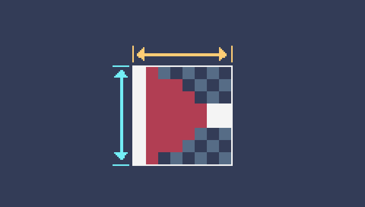
>
> 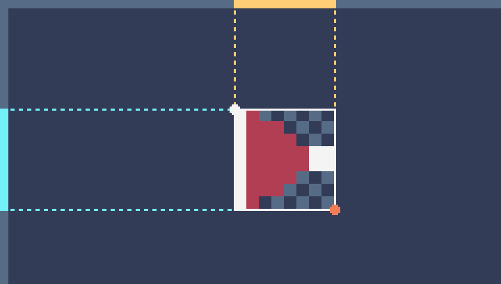

> 🧰 **Deux boîtes se touchent** quand elles se chevauchent sur X et sur Y. Quelles comparaisons sont vraies de 10–18 contre 15–23, et fausses contre 20–28 ?
>
> 
> <!-- ws:anim {src: img/collision-deux-axes.webm, chapters: img/collision-deux-axes.vtt} -->
>
> 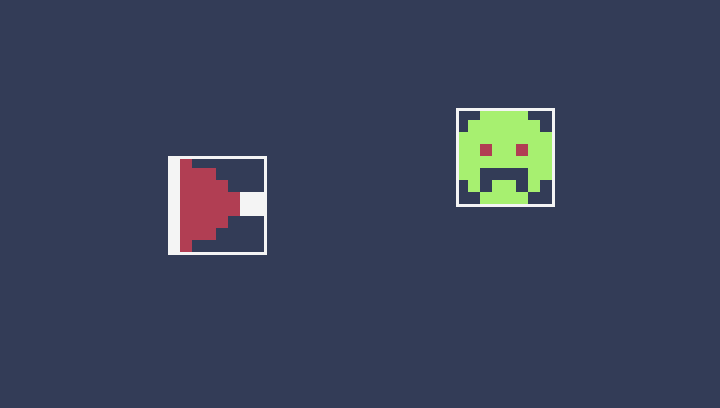
>
> 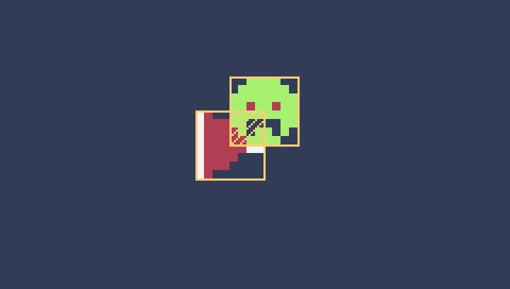
<!-- /ws:toolbox -->

### Mise en application
<!-- ws:doit -->

**Ton objectif :** une condition qui détecte le contact, et réinitialise les deux positions.

<!-- illustration: GIF : l'ennemi arrive sur le bonnet : au contact, les deux sont replacés à leur position de départ -->

**C'est réussi si :** le contact renvoie les deux sprites au départ, un passage à côté ne fait rien.

## Enemy VS Bullet
<!-- ws: {type: exercise, id: collision-enemy-bullet} -->

Même méthode entre le missile et l'ennemi. Cette fois, toucher rapporte des points.

<!-- ws:toolbox -->
### Boîte à outils

> 🧰 **`print(texte, x, y, couleur)`** écrit sur l'écran. Après `cls`, sinon le texte est effacé.
>
> ```lua
> print("BONJOUR", 10, 20)
> ```
>
> Doc TIC-80 (en anglais) : [`print`](https://github.com/nesbox/TIC-80/wiki/print#parameters)

> 🧰 **`..`** colle un texte et un nombre.
>
> ```lua
> vies = 3
> print("VIES: " .. vies)   --> VIES: 3
> ```
>
> Doc Lua (en anglais) : [la concaténation](https://www.lua.org/manual/5.3/manual.html#3.4.6)
<!-- /ws:toolbox -->

### Mise en application
<!-- ws:doit -->

**Ton objectif :** une variable `score`, +100 par ennemi touché, affichée à l'écran. Le missile est remis prêt à être tiré, l'ennemi replacé à droite.

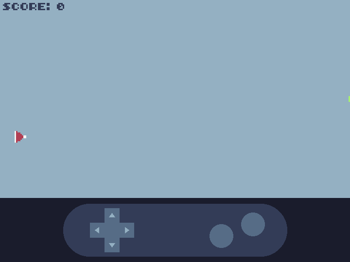

**C'est réussi si :** le score monte à chaque ennemi touché, pas quand le missile le rate.

## Bonus : fonction check_collision
<!-- ws: {type: exercise, id: collision-check-collision, optional: true} -->

Tes deux tests font le même calcul avec des variables différentes. Un code écrit deux fois, c'est une fonction qui attend.

<!-- ws:toolbox -->
### Boîte à outils

> 🧰 **Une fonction** reçoit des valeurs entre parenthèses et renvoie un résultat avec `return`.
>
> ```lua
> function double(n)
>   return n * 2
> end
> print(double(4))   --> 8
> ```
>
> 
> <!-- ws:anim {src: img/outil-fonction.webm, chapters: img/outil-fonction.vtt} -->
>
> Doc Lua (en anglais) : [les fonctions](https://www.lua.org/manual/5.3/manual.html#3.4.11)
<!-- /ws:toolbox -->

### Mise en application
<!-- ws:doit -->

**Ton objectif :** `check_collision` reçoit deux boîtes (position, largeur, hauteur) et répond `true` ou `false`. Tes deux tests l'appellent.

**C'est réussi si :** le jeu joue comme avant, avec un seul calcul de collision.

## Fin de la partie 1

Ton jeu est jouable : le joueur bouge, il tire, les ennemis arrivent et le score monte.

Dans la partie suivante, tu vas t'occuper de ce que le joueur voit.
